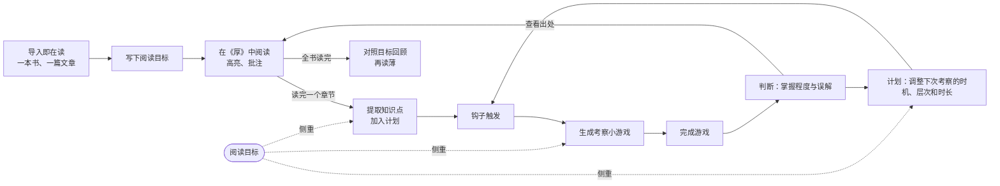

# 《厚》产品方案

状态：目标定义、用户流程、功能设计已确认。调研验证待确认，产品方案、技术方案尚未开始。2026-11-02 新增"一本书，一篇文章"的在读名额（导入即在读，没有待读和搁置）、每本读物的阅读目标和"旧书复习"设置，原型已同步；新增统一阅读格式，由独立包 `packages/doc` 维护。

## 产品定位

以 AI 为引擎、以行动为中心的 macOS 学习应用。钩子在合适的时刻触发，LLM 通过考察、判断、计划三种能力，持续检测并提升用户对所学内容的理解。笔记作为知识来源留在背后，只在被引用时出现。

| 能力 | 职责 |
|---|---|
| 考察 | 检测用户最近所学内容的理解是否到位，按理解、应用、分析、评价、创造逐级出题，每次换角度。考察以 AI 即时生成的交互式 HTML 小游戏呈现 |
| 判断 | 根据作答识别掌握程度和具体误解；判断当前时刻是否应该打扰用户 |
| 计划 | 根据判断结果安排重讲、加练或推进，并决定下一次考察的时机 |

## 品牌

| 项目 | 决定 |
|---|---|
| 名称 | 《厚》，取自"把书读厚，再把书读薄" |
| 应用图标 | `brand/icon/hou-icon-master.png`：宣纸底上，五层淡墨层层晕染叠成一座山，叠墨处自然加深；纯平面水墨，没有立体效果。全部品牌物料见 `brand/brand-guidelines.md`，总览页为 `brand/index.html` |
| 图标含义 | 每一层是读厚时叠加的理解，层层累积成山（积土成山） |

## 目标定义

### 最终用户

产品作者本人：全栈开发者，正在转型独立开发者和自媒体人，当前在系统学习交互设计和视觉设计。

### 使用场景

- 在 Mac 上阅读书籍（PDF、EPUB）、文章与网页，并在思源或 Markdown 中写读书笔记和主题卡。
- 日常工作时，通过菜单栏和系统通知收到钩子，用几分钟完成一次考察。

### 要解决的问题

| 问题 | 表现 |
|---|---|
| 读完就忘 | 读过的书和文章，几周后说不出要点 |
| 以为懂了 | 能复述概念，但遇到真实界面时不会运用 |
| 不知道下一步学什么 | 没有计划，学习顺序和节奏凭感觉 |
| 靠毅力坚持 | 一旦工作变忙，学习就中断，之后很难恢复 |

### 第一版范围

| 维度 | 决定 |
|---|---|
| 平台 | 独立 macOS 桌面应用 |
| 用户 | 仅作者本人 |
| 内容来源 | 在《厚》中导入并阅读的书籍（PDF、EPUB）和网页；阅读时的高亮与批注作为个人笔记 |
| 不在第一版范围 | 其他用户、视频与课程内容、关联外部笔记库（思源、Markdown 文件夹）、自媒体输出与发布、打扰策略（是否该打扰的判断、送达方式分层、用户自定义送达）、移动端、Web 端 |

### 推进方式

第一版不设成功指标，作者边开发边使用，根据实际体验迭代。

长期方向：面向"想成长但不知如何行动"的普通人发布的 macOS 应用。

## 用户流程

### 整体循环

### 一本书，一篇文章

没有"待读"：导入即开始读。同一时间最多在读一本书和一篇文章，只有读完归档的没有上限。目的是逼自己把手上的读完，不让未读内容越堆越多。

| 状态 | 书（PDF、EPUB） | 文章（网页、粘贴的正文） | 能否阅读 | 是否继续考察 |
|---|---|---|---|---|
| 在读 | 1 | 1 | 是 | 是 |
| 归档 | 不限 | 不限 | 可以回看 | 按"旧书复习"设置 |

| 操作 | 规则 |
|---|---|
| 导入 | 直接成为在读。同类的在读名额已占用时不能导入，提示先把在读的那一本读完或放弃 |
| 读完 | 在读 → 归档，标记"读完"，进入"对照目标回顾" |
| 放弃 | 在读 → 归档，标记"未读完"；须写一句理由。理由和放弃时间保留在归档中 |

没有"搁置"：读到一半只能继续读完，或者写下理由放弃。

旧书复习：归档读物中已提取的知识点是否继续按计划复习，在设置中选择，默认继续。关闭后这些知识点不再出题，掌握程度和历史记录保留，重新打开后由计划器重新安排。单本也可以在"今天"页单独暂停。

### 流程一：导入即开始阅读

1. 用户导入内容：拖入 PDF 或 EPUB 文件，或者粘贴网页链接。如果同类的在读名额已占用，先提示把那一本读完或放弃，不能导入。
2. 导入后这本书或文章直接成为"在读"。
3. 开始读之前写下这本书的阅读目标，两个问题各一句话，都可以跳过：
   - 想从这本书得到什么：例如"弄清楚好界面背后的原则，能说出为什么好"。
   - 想学会哪些内容：例如"信息层次、留白、一屏只突出一件事"。
4. 阅读过程中可以随时修改目标；修改后旧目标存入该书的历史，不删除。

### 流程二：阅读与提取

1. 内容在《厚》的阅读器中打开，阅读器顶部可以展开查看本书的阅读目标。用户阅读时可以高亮和批注。
2. 用户读完一个章节（书籍按目录章节，网页按整篇）时，在阅读器中标记"读完"。
3. 《厚》从该章节原文提取知识点，以卡片形式展示提取结果。有阅读目标时，每个知识点标注与目标的相关程度（高、中、低）和一句理由，按相关程度排序。用户可以删除不想被考察的知识点，或者修改相关程度；不做操作即全部保留。
4. 知识点进入计划，计划安排首次考察。
5. 最后一章读完后，提示把全书标记为读完，并进入"对照目标回顾"。

阅读目标起作用的地方：

| 环节 | 有阅读目标时 | 没有阅读目标时 |
|---|---|---|
| 知识点提取 | 标注相关程度和理由；相关程度低的也保留 | 不标注 |
| 计划 | 同等紧迫时，相关程度高的知识点优先考察、更快推进到"能应用"；相关程度低的保持复习，间隔可以更长 | 只按掌握程度和时间安排 |
| 考察 | "应用"及以上层次的情境优先取自目标描述的场景 | 情境由考察生成器自由选择 |
| 对照目标回顾 | 逐条对照目标：已掌握的、仍薄弱的、书中提到但还没考到的 | 只汇总全书知识点的掌握程度 |

### 对照目标回顾（再读薄）

全书标记读完时生成一页回顾：本书的阅读目标、与目标相关的知识点及掌握程度、仍薄弱的地方和对应原文。用户可以在回顾页用几句话写下自己从这本书得到的观点，作为"读薄"的结果保存在该书下。

### 流程三：钩子触发与考察

1. 钩子触发，来源有三种：计划中的考察到期；章节标记读完后的首次考察；用户按全局快捷键主动领取。
2. 考察送达用户：

   | 送达方式 | 第一版行为 |
   |---|---|
   | 菜单栏图标 | 有待完成的考察时显示数量标记，点击展开待完成列表 |
   | 系统通知 | 每次计划触发考察时弹出，点击进入考察 |
   | 定时弹出窗口 | 在用户设定的固定时段直接弹出考察窗口 |
   | 全局快捷键 | 用户主动领取：由计划选出当前最需要考察的知识点 |

3. 用户进入考察后，《厚》生成考察小游戏，生成期间显示进度。
4. 小游戏在独立窗口中运行，用户完成作答。
5. 判断给出结果：每个知识点的掌握程度、具体误解、对应原文出处。点击出处可跳转到阅读器中的原文位置。
6. 用户认同结果，或者提出异议。
7. 计划根据结果更新：下一次考察的时机、考察层次和时长。

### 流程四：查看与调整计划

主窗口"今天"页展示：在读的书和文章及各自的阅读目标、待完成的考察、接下来的考察安排、各书籍和章节下知识点的掌握程度。用户可以暂停某本书的考察，或者把某个考察延后。

### 考察小游戏的约束

- 输入固定：知识点、原文片段、考察层次、时长预算，以及知识点所属书籍的阅读目标（可为空）。
- 输出固定：用户的操作过程、最终作答、完成状态。每个游戏结束时必须产出可供判断的作答。
- 游戏内容由 LLM 完全自由生成。
- 考察生成方式可插拔：第一版只有"自由生成"一种，后续可以接入模板库等其他生成方式，不影响判断和计划。

### 异常与分支

| 情况 | 处理 |
|---|---|
| 尚未导入任何内容 | 主窗口引导用户导入书籍或网页；快捷键领取时提示"还没有可考察的内容" |
| 有归档但没有在读 | "今天"页引导用户导入一本书或一篇文章；旧书按"旧书复习"设置考察 |
| 在读名额已占用，又想导入 | 不能导入；提示先把在读的那一本读完或放弃。不提供"先存着以后再读"的入口 |
| 放弃时没有写理由 | 不能完成操作，理由为必填 |
| 关闭"旧书复习" | 归档读物的知识点停止出题，已到期但未完成的考察移出待完成列表；在读内容的考察不受影响 |
| 跳过阅读目标 | 照常阅读、提取和考察，不标注相关程度；阅读器顶部保留一行"写下阅读目标"的入口 |
| 阅读中修改目标 | 旧目标存入该书历史；已提取的知识点在下一次计划更新时重新评估相关程度，已有考察记录不变 |
| 有内容但没有到期考察 | "今天"页显示下一次考察的时间；快捷键仍可主动领取 |
| 网页导入失败（需要登录、付费墙、无法解析） | 明确提示失败原因，用户可以改为粘贴正文导入 |
| 通知没有响应 | 考察保留在菜单栏待完成列表；超过 24 小时未完成，由计划重新安排时机 |
| 游戏生成失败（模型请求失败、超时） | 显示失败原因和重试按钮；本次不计入掌握程度 |
| 游戏运行出错（脚本报错、无法完成、没有按约定输出作答） | 终止该游戏，提示失败并提供重新生成；本次不计入掌握程度，完整记录用于排查 |
| 用户中途关闭游戏窗口 | 不判分，考察回到待完成列表 |
| 用户不认同判断结果 | 用户可以填写理由，判断结合理由复核一次；仍不认同时以用户结论为准，两次结论都记录 |
| 用户删除一本书 | 按"放弃"处理：须写理由，该书归档并标记"未读完"，历史作答记录保留 |

## 功能设计

### 可插拔组件

考察、计划、掌握程度评分是《厚》的核心决策环节，各自设计为可替换的组件。组件之间只通过固定的输入输出交互，替换任意一个不影响其他环节。

| 组件 | 输入 | 输出 | 第一版实现 |
|---|---|---|---|
| 考察生成器 | 知识点、原文片段、考察层次、时长预算、所属书籍的阅读目标（可为空） | 可运行的考察小游戏 | LLM 自由生成 HTML |
| 计划器 | 知识点的掌握程度、与目标的相关程度、历次判断结果、当前时间 | 每个知识点的下次考察时间、考察层次、时长预算，以及决策理由 | LLM 决策 |
| 掌握程度评分 | 判断给出的作答分析 | 每个知识点的掌握程度 | 5 档评分（见下表） |

第一版 5 档掌握程度：

| 档位 | 名称 | 判断依据 |
|---|---|---|
| 1 | 未掌握 | 作答显示不理解，或存在关键误解 |
| 2 | 能识别 | 能认出正确说法，但无法自己解释 |
| 3 | 能解释 | 能用自己的话正确解释 |
| 4 | 能应用 | 能在新情境中正确运用 |
| 5 | 能迁移 | 能分析、评价，或用到自己的作品中 |

### 功能清单

优先级说明：P0 是主循环（阅读、提取、触发、考察、判断、计划）运行所必需的功能；P1 是第一版包含、但主循环不依赖的功能。

**书架与阅读目标**

| 功能 | 说明与边界 | 优先级 |
|---|---|---|
| 书架 | 分在读、归档两组展示所有读物；归档中区分"读完"和"未读完" | P0 |
| 一本书，一篇文章 | 导入即在读；书和文章各一个名额，名额已满时不能导入 | P0 |
| 放弃 | 在读直接归档并标记"未读完"，须写理由 | P0 |
| 设定阅读目标 | 导入后、开始读之前填写"想得到什么""想学会哪些内容"，各一句话，可以跳过；阅读中可以修改 | P1 |
| 目标历史 | 修改时保存旧目标与起止时间，供运行记录和回顾页回看 | P1 |
| 相关程度标注 | 提取知识点时标注与本书目标的相关程度和理由；用户可以在知识点卡片上修改 | P1 |
| 按目标侧重 | 计划器优先安排相关程度高的知识点；考察生成器在"应用"及以上层次优先使用目标场景 | P1 |
| 对照目标回顾 | 全书读完时生成回顾页，用户可以写下自己的观点 | P1 |

不包含：待读列表、搁置、调整在读名额、跨书的总目标、把目标拆成路线图、按目标推荐书籍、目标完成度百分比。

**内容库与阅读器**

| 功能 | 说明与边界 | 优先级 |
|---|---|---|
| 导入 PDF、EPUB | 拖入或选择文件；原始文件保存到本地资料库，同时转换为统一阅读格式 | P0 |
| 导入网页 | 粘贴链接，按来源分流提取正文（见下方"统一阅读格式"），转换为统一阅读格式保存；图片下载到本地；提取失败时提示原因 | P0 |
| 粘贴正文导入 | 网页导入失败时的替代方式，需填写标题 | P0 |
| 阅读器 | 只显示统一阅读格式，排版按设计规范的 reading 样式；目录导航、记住阅读位置 | P0 |
| 查看原版 | PDF 转换效果不好时（表格、公式错乱），可以对照原始文件查看；高亮与考察仍以统一格式为准 | P1 |
| 章节划分 | 统一按转换结果中的章节划分：EPUB 和带目录的 PDF 按目录；没有目录的 PDF 由用户按页码范围划分；网页按整篇 | P0 |
| 标记章节读完 | 触发知识点提取 | P0 |
| 定位原文 | 从判断结果跳转到原文对应位置 | P0 |
| 高亮与批注 | 作为知识点提取和考察侧重的参考 | P1 |
| 归档书籍 | 读完或放弃后归档，不占名额；是否继续考察按"旧书复习"设置；保留历史记录 | P0 |

不包含：翻译、全文搜索、云同步、外部笔记库关联。

**统一阅读格式**

所有来源导入时都转换为同一种内部格式，阅读器、高亮、原文定位、知识点提取只处理这一种格式。格式定义与转换逻辑放在独立的包 `packages/doc` 中维护，不依赖应用本身，未来可以在服务器上运行，供多端共用。规范见 `packages/doc/SPEC.md`。

| 项目 | 决定 |
|---|---|
| 结构 | 一份读物 = 元信息（标题、作者、来源、导入时间）+ 章节列表；章节由内容块组成 |
| 内容块 | 标题、段落、引用、列表、代码、图片、表格、公式、分隔线；段落内支持加粗、斜体、行内代码、链接、行内公式 |
| 原文定位 | 每个块有固定编号；高亮、批注、知识点出处统一记录为"块编号 + 字符位置" |
| 不可变 | 导入后的文档不再修改；重新转换生成新版本，旧版本的定位通过文本比对迁移 |
| 图片 | 全部下载到本地，文档内只引用本地资源 |

各来源的转换方式：

| 来源 | 方式 | 第一版 |
|---|---|---|
| EPUB | 按目录拆分章节，每章 HTML 转为内容块 | P0 |
| 一般网页 | defuddle 提取正文，失败时改用 Readability，再转为内容块 | P0 |
| 微信公众号 | 专门解析：取正文区域，图片从 `data-src` 下载到本地，清理公众号样式 | P0 |
| X（推特） | 通过 FxTwitter 接口获取单条推文、串推或长文章，拼成文章 | P1 |
| 文字型 PDF | 转换工具选型在技术方案阶段确定（候选 Docling；Marker、MinerU 等 GPL/AGPL 工具不直接使用） | P0 |
| 扫描版 PDF | 需要文字识别，第一版提示暂不支持 | 不包含 |
| 粘贴正文 | 按空行分段，整篇作为一个章节 | P0 |

**知识点提取**

| 功能 | 说明与边界 | 优先级 |
|---|---|---|
| 从章节提取知识点 | 每个知识点包含名称、解释、原文位置；参考该章节的高亮与批注 | P0 |
| 提取结果确认 | 以卡片展示，用户可删除；不操作即全部保留 | P0 |
| 提取失败处理 | 显示失败原因和重试按钮 | P0 |

不包含：手动新增知识点、编辑知识点内容、跨书合并知识点。

**钩子与送达**

| 功能 | 说明与边界 | 优先级 |
|---|---|---|
| 计划到期触发 | 计划器给出的考察时间到达时触发 | P0 |
| 章节读完触发 | 标记读完并完成提取后，由计划器安排首次考察 | P0 |
| 全局快捷键领取 | 由计划器选出当前最需要考察的知识点；快捷键可在设置中修改 | P0 |
| 菜单栏图标 | 显示待完成考察数量，点击展开列表 | P0 |
| 系统通知 | 计划到期时弹出，点击进入考察 | P0 |
| 定时弹出窗口 | 在设置的固定时段直接弹出考察窗口；未设置时段则不弹出 | P1 |
| 超时重排 | 考察超过 24 小时未完成，由计划器重新安排 | P1 |

**考察**

| 功能 | 说明与边界 | 优先级 |
|---|---|---|
| 生成考察小游戏 | 由考察生成器生成，一次考察覆盖的知识点数量和时长由计划器决定；生成期间显示进度 | P0 |
| 运行前检查 | 生成后在后台加载，确认没有脚本错误、存在作答提交入口；不通过按生成失败处理 | P0 |
| 隔离运行 | 游戏在独立窗口运行，不能访问网络和本地文件 | P0 |
| 作答输出 | 按固定格式输出操作过程、最终作答、完成状态 | P0 |
| 失败与中断处理 | 生成失败、运行出错、中途关闭，均不计入掌握程度，考察回到待完成列表 | P0 |

**判断**

| 功能 | 说明与边界 | 优先级 |
|---|---|---|
| 作答判断 | 以原文为依据，给出每个知识点的掌握程度、具体误解、原文出处 | P0 |
| 结果反馈页 | 展示判断结果、计划器的下次安排和理由 | P0 |
| 异议与复核 | 用户填写理由后复核一次；仍不认同时以用户结论为准，两次结论都记录 | P1 |

**计划与主窗口**

| 功能 | 说明与边界 | 优先级 |
|---|---|---|
| 计划更新 | 每次判断后由计划器更新相关知识点的下次考察 | P0 |
| "今天"页 | 待完成的考察、接下来的安排、按书籍和章节汇总的掌握程度；顶部显示在读的书和文章及各自的阅读目标，并增加"与目标相关"的掌握程度汇总 | P0 |
| 暂停与延后 | 暂停某本书的全部考察；把单个考察延后 | P1 |

**运行记录**

| 功能 | 说明与边界 | 优先级 |
|---|---|---|
| 完整记录 | 每次钩子执行记录：触发原因、发给 LLM 的内容、组件版本、模型、输出、生成的游戏、用户作答、判断与计划结果 | P0 |
| 运行记录查看 | 按时间浏览，可查看单次执行的全部细节，可重新打开当时生成的游戏 | P1 |

**设置**

| 功能 | 说明与边界 | 优先级 |
|---|---|---|
| 模型服务配置 | 填写模型服务的密钥；未配置时，所有依赖 LLM 的操作明确提示需要先配置 | P0 |
| 旧书复习 | 归档读物的知识点是否继续出题，默认继续 | P0 |
| 定时弹出时段 | 设置每天的固定考察时段 | P1 |
| 快捷键 | 修改全局快捷键 | P1 |

## 调研验证

调研时间：2026-10-26。

### 同类产品验证了什么

| 产品 | 做法 | 对《厚》的验证 |
|---|---|---|
| NotebookLM | 测验和闪卡只基于用户上传的资料生成；2026 年加入掌握程度追踪 | 验证"以原文为依据"的做法。基于资料的选择题和闪卡已有成熟产品，《厚》的差异在于主动触发、交互游戏和计划 |
| Google Learn Your Way | 把教材转成带即时反馈的交互测验等形式；效果研究中，长期记忆测试得分比使用普通电子阅读器的学生高 11 个百分点 | 验证"阅读加交互考察加即时反馈"能提升长期记忆。研究细节在技术报告中，未逐项核实 |
| AI 学习游戏平台 | 先生成问答对，再套用不同的游戏外壳，同一组问答驱动所有玩法 | 提供"考察内容与游戏外壳分离"的做法 |

### 学习科学证据

| 研究 | 结论 | 对《厚》的影响 |
|---|---|---|
| Adesope 等 2017，练习测试元分析 | 练习测试比重读和其他对照方式更有利于学习；效果受测试特征、反馈等因素调节 | 支持以考察代替重读、考察后给出反馈的设计 |
| Sailer 与 Homner 2019，游戏化元分析 | 对认知结果有小到中等的正向效果（g = 0.49），在高质量研究中依然成立；对动机和行为的效果较不稳定；哪些因素让游戏化提升认知仍不明确 | 游戏形式有帮助，但不保证学习效果，考察的核心必须是提取和运用知识 |
| AI 生成教育互动小说试点研究（2026） | 生成可运行的作品已经可行，但让游戏规则与学习内容有意义地结合仍然困难 | 自由生成的游戏可能考的是"会不会操作游戏"，而不是"懂不懂知识点" |

### LLM 判分可信度

| 研究 | 结论 |
|---|---|
| 可持续发展课程简答题判分（2026，同行评审） | 4 个模型与人工评分的一致性为中等（QWK 0.585–0.640），认知层次越高一致性越低，高阶能力的判分一致性明显偏低 |
| 计算语言学课程判分（2025 预印本） | 提供标准答案和评分细则时，总体相关系数 0.98，完全一致 55%，模型倾向于少给分；评分细则越明确，一致性越高；建议要求模型说明扣分理由、人工抽查、固定采样参数 |

结论：判分在"能识别、能解释"层面基本可用；在"能应用、能迁移"层面可信度明显下降，而这两档正是《厚》最想检测的。提供标准答案和明确的评分细则，是提高判分一致性的主要手段。

### 可复用的基础设施

| 需求 | 候选 | 调研结论 |
|---|---|---|
| 桌面应用外壳 | Tauri 2（Apache-2.0）、Electron（MIT） | 两者都提供菜单栏图标、系统通知、全局快捷键。Tauri 使用系统 WebKit，安装包和内存占用更小；其通知插件从 2.6.0（2026-10-10）起支持桌面端点击通知的回调。Electron 内置 Chromium，体积更大，API 更成熟；macOS 上通知要求应用签名。选择在技术方案阶段确定 |
| EPUB 解析 | foliate-js（MIT）、epub.js | 阅读器改为统一格式后，只用于解析 EPUB 结构和目录，不再负责渲染。foliate-js 支持 EPUB 渲染、批注叠加层、EPUB CFI（用于定位原文）；作者声明接口不稳定，需要固定版本。Readest 基于 foliate-js，但 Readest 本身是 AGPL-3.0，只参考做法，不复制代码，避免《厚》被 AGPL 约束 |
| PDF 查看原版 | pdf.js（Apache-2.0） | 只用于"查看原版"；原文定位统一使用块编号加字符位置 |
| PDF 转换 | Docling（据称 MIT，需核实）、Marker（GPL-3.0）、MinerU（AGPL-3.0） | Marker、MinerU 效果好但许可证会约束《厚》，不直接使用。Docling 为 Python，可在转换服务中运行。选择在技术方案阶段确定 |
| X 内容 | FxTwitter 接口 | 无需登录即可获取推文、串推和长文章 JSON；第三方服务，无可用性保证，受保护账号无法获取 |
| 网页正文提取 | defuddle（MIT，输出 Markdown）、Readability（Apache-2.0） | 两者均可用；defuddle 为首选，Readability 兜底。微信公众号和 X 需要专门适配 |
| 游戏隔离运行 | 浏览器 iframe 沙箱加内容安全策略 | 禁止同源访问和网络请求，通过消息通道传回作答，两种外壳都支持 |
| 计划算法（后续可插拔） | ts-fsrs（MIT） | 第一版计划器使用 LLM，后续接入间隔重复算法时可直接使用 |

### 调研结论对方案的调整

| 调整 | 依据 |
|---|---|
| 考察生成拆为两步：先生成"考察规格"（考哪些知识点、考察层次、标准答案、评分细则），再根据考察规格生成游戏。判断以考察规格为依据评分 | 明确的评分细则是判分可信的主要手段；内容与游戏外壳分离后，游戏仍可完全自由生成，同一知识点多次考察的结果可以比较 |
| 判断必须为每个知识点给出评分理由 | 评分理由便于发现判分的系统性偏差，也是用户提出异议的依据 |
| "异议与复核"从 P1 提升为 P0 | 高阶层次判分可信度低，用户纠正是第一版必须具备的能力 |

### 参考来源

- [Google Learn Your Way](https://blog.google/outreach-initiatives/education/learn-your-way/)
- [NotebookLM 2026 年 4 月更新](https://pasqualepillitteri.it/en/news/1391/notebooklm-april-2026-update-auto-label-flashcards)
- [AI 学习游戏工具综述](https://flashcard-maker.cc/blog/ai-study-games/)
- [Adesope 等 2017](https://journals.sagepub.com/doi/10.3102/0034654316689306)
- [Sailer 与 Homner 2019](https://link.springer.com/article/10.1007/s10648-019-09498-w)
- [AI 生成教育互动小说试点研究](https://arxiv.org/pdf/2608.10818)
- [可持续发展课程简答题判分](https://avesis.mcbu.edu.tr/yayin/8adc6694-7e10-4913-8d60-0c817f9f764d/automatic-short-answer-grading-in-sustainability-education-ai-human-agreement)
- [LLM-as-a-Grader](https://arxiv.org/html/2511.10819v2)
- [Tauri 通知插件 2.6.0](https://v2.tauri.app/release/notification/v2.6.0/)、[Electron Notification](https://www.electronjs.org/docs/latest/api/notification)
- [foliate-js](https://github.com/johnfactotum/foliate-js)、[pdf.js](https://github.com/mozilla/pdf.js)、[defuddle](https://github.com/kepano/defuddle)、[Readability](https://github.com/mozilla/readability)、[ts-fsrs](https://github.com/open-spaced-repetition/ts-fsrs)
